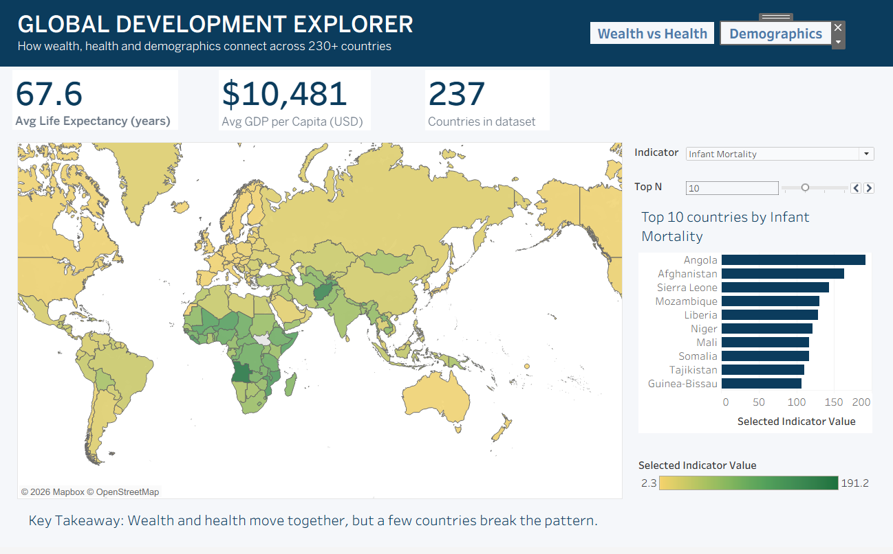
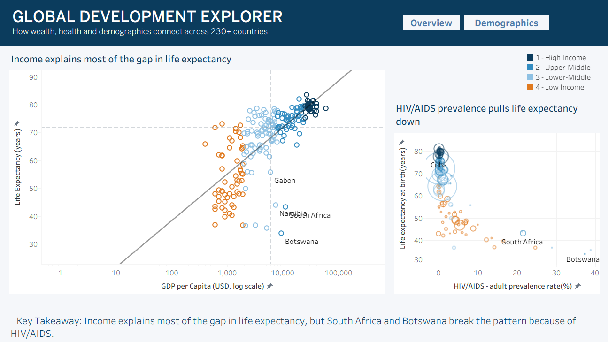
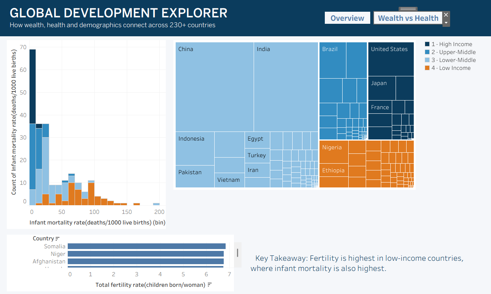
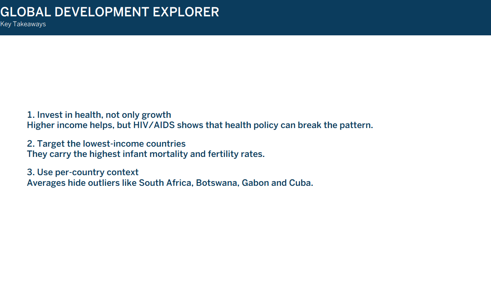
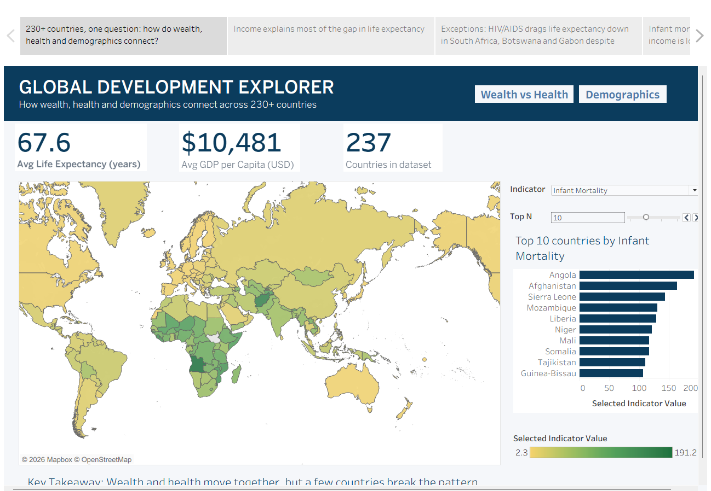

# Global Development Explorer

**How wealth, health and demographics connect across 230+ countries**, an interactive Tableau project with three linked dashboards and a five-page data story.

> Course project: *Mini-Project 3, Advanced Tableau Storytelling & Interactive Analytics*.

**[View the live dashboards on Tableau Public](https://public.tableau.com/views/Book1_17916372636480/Overview)**

## What's inside

| Dashboard | What it shows |
|---|---|
| **Overview** | KPI cards, a world map with a switchable indicator, and a Top N ranking |
| **Wealth vs Health** | GDP per capita vs life expectancy (quadrants, trend line, flagged outliers) and HIV/AIDS prevalence vs life expectancy |
| **Demographics** | Infant mortality distribution, population treemap and the countries with the highest fertility |
| **Key Takeaways** | Three recommendations drawn from the analysis |

A **Tableau Story** (5 pages) walks through the findings in the same order.

## Interactivity

- **Indicator selector**: switch the map and ranking between GDP per capita, life expectancy and infant mortality.
- **Top N parameter**: show the top 5 to 20 countries.
- **Map to KPIs**: click a country on the map and the KPI cards show that country.
- **Income Highlight**: click a point and every country in the same income group is highlighted.
- **Histogram to Treemap**: click a histogram bar to filter the treemap to those countries.
- **Navigation buttons** between the dashboards.

## Technical highlights

- 6 visualization types: filled map, scatter plot with trend line, bar chart, histogram, treemap, bubble chart.
- Parameters: `Select Indicator`, `Top N`.
- Calculated fields: `Income Group` (GDP per capita bands), `Selected Indicator Value` (driven by the parameter), `Anomaly Flag` (a `FIXED` LOD expression comparing each country with the median GDP per capita and median life expectancy), KPI measures.
- Fixed 1300 x 800 layout with a consistent design system (navy header, one accent colour, one font family).

## Key findings

- Income and life expectancy move together: the correlation between log GDP per capita and life expectancy is about **0.73**.
- Life expectancy and infant mortality are strongly negatively correlated (about **-0.89**).
- Outliers: **South Africa, Botswana and Namibia** have above-median income but life expectancy 10+ years below the median. All three have HIV/AIDS adult prevalence of 21-37%, which is consistent with the gap (Gabon is also flagged, but it sits right at the income median). **Cuba** is the reverse case: low income, high life expectancy.
- Infant mortality and fertility are highest in the lowest-income countries.

These are descriptive patterns in one snapshot of data, not proof of causation.

## Screenshots

## How to open the project

1. Download `Global_Development_Explorer.twbx`.
2. Open it with Tableau Public or Tableau Desktop (the workbook was built with a recent version, 2026.2, so use an up-to-date install).
3. The data is packaged inside the file, so nothing else is needed.

## Data

- **Source:** *Country Data Comparison* (course dataset). One row per country or territory, 45 indicators on economy, demographics and public health.
- **Cleaning:** the original file used `;` as the delimiter and had a second row of data types, so I removed that row and re-saved it as a standard CSV. An `Entity Type` column marks aggregates (European Union) and rows without population data, and a data source filter keeps only `Country/Territory`. The cleaned file is in [`data/`](data/Country_Data_Clean.csv).
- **Map matching:** `Congo Republic of the` was matched to Congo and `Serbia and Montenegro` to Serbia.

### Limitations

- The dataset is an **older snapshot** (it still lists entities such as Serbia and Montenegro and the Netherlands Antilles), so the figures are not current and should not be read as today's numbers.
- It is **cross-sectional**: there is no time dimension, so the "trend" is a relationship between two indicators, not a change over time.
- Some indicators have many missing values, which is why the dashboards focus on GDP, life expectancy, infant mortality, fertility, population and HIV/AIDS.

## Tools

Tableau Public.

## Author

Fatima Awad
